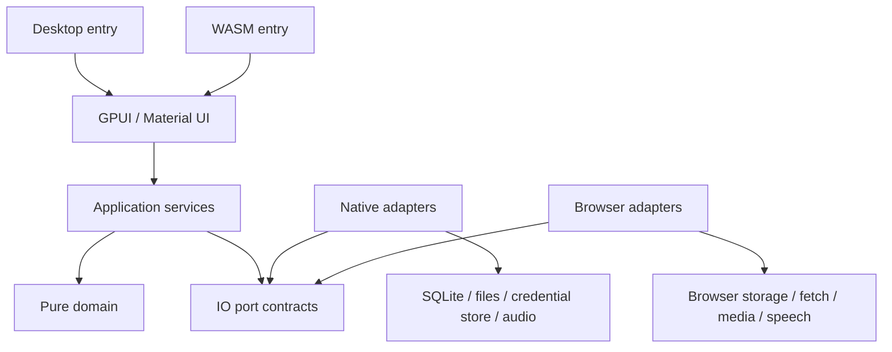

# 目标架构

**这是待实现架构。** 当前仓库仍是 `apps/web`＋`packages/*` 的 TypeScript 工程；新 Rust workspace 在 R01 建立，旧目录在迁移验收前保留。

## 依赖方向



入口负责装配适配器。领域层不依赖 GPUI、SQLite、HTTP、文件系统或特定 executor；应用服务通过接口执行业务、记录事件和协调异步任务。UI 只能发命令／查询并观察状态，不能直接写数据库或调用模型。

## 规划目录

```text
crates/
  cijian-domain/          # FSRS封装、时间、词形／覆盖率、选词、统计纯规则
  cijian-ports/           # Repository/UoW、LLM/TTS、Blob、Audio、Secret等契约
  cijian-app/             # 用例、验证、事件、任务与幂等
  cijian-storage/         # 原生SQLite、迁移、备份导入／导出
  cijian-providers/       # OpenAI兼容协议、结构输出和调用日志适配
  cijian-platform/        # 原生文件选择、音频、系统朗读、凭据、生命周期
  cijian-ui/              # 主题、导航、页面、应用控件；依赖gpui-kit facade
  cijian-testing/         # test-only doubles与固定时钟、随机源
apps/
  desktop/               # cijian-desktop binary
  wasm/                  # cijian-wasm：浏览器入口与浏览器专属适配器
  web/                   # 现有Next.js，迁移对照
packages/                # 现有TS实现与测试；逐模块迁移
prompts/                 # 版本化文本资产，编译／打包时嵌入
fixtures/                # 共享原创样例和跨语言向量
```

R00 确认 crate 名与边界可编译后固定，不能把上图当已有模块。优先少量清晰 crate；平台条件编译留在适配器与入口，不散入领域规则。

## 关键技术与状态

| 层 | 选择 | 实施要求 |
| --- | --- | --- |
| UI | GPUI＋gpui-kit＋gpui-kit-material | Kit facade 导入匹配引擎；全量 Git revision 与 root patches 一起锁定 |
| 主题 | 词间语义 token | 映射 Material theme；初始化在 Root 首次绘制之前，render 不更新全局主题 |
| 调度 | Rust FSRS 实现 | 选型、参数／版本转换与跨语言向量在 R00/R02 验证 |
| 原生存储 | SQLite | SQL迁移、仓储、事务；具体 Rust driver 在 R00 验证后锁定 |
| 边界校验 | Rust typed DTO＋显式约束 | serde 反序列化不代替范围／跨字段校验 |
| 网络 | OpenAI兼容 LLM/TTS，transport 接口 | 桌面／WASM transport 分离；超时、取消、计数统一 |
| 异步 | GPUI task 与后台 executor 桥接 | 阻塞 SQLite／APKG 放后台，UI 线程只更新视图 |
| 音频 | AudioPlayer＋SystemSpeech ports | 缓存播放、seek／rate capability；浏览器走媒体API |
| 凭据 | SecretStore | 桌面优先系统凭据存储；浏览器默认会话内，无假定等价安全保证 |
| 校验工具 | cargo fmt/clippy/test＋UI harness | 命令在 workspace 存在后启用；旧TS检查继续用于旧代码 |

上游 Material 是预发布 Git 依赖，默认 GPUI Fast，但后端选择必须通过消费者最小程序验证。不要把另一版本 `gpui` 直接加入依赖形成不兼容的 Entity/Context 类型。上游要求的 consumer patches 放 workspace 根且来源 revision 一致，不能依赖开发机相邻 checkout。

## 应用接口

接口名称是领域契约，不是对外稳定 ABI。R01/R03 细化 Rust 签名与异步 trait 策略。

| 用例 | 输入／输出关键字段 |
| --- | --- |
| query_today / query_stats | ProfileId、now、过滤范围 → 与首页／统计共享的投影 |
| import_words | operationId、file handle、kind、target → ImportReport |
| review_preview / rate_card | cardId、expectedRevision、rating、duration → 状态／四档预览 |
| generate_article | operationId、tier、genre → JobId；订阅 JobState |
| lookup_word | articleId、bodyHash、UTF-8 range → GlossView＋标记状态 |
| mark_word / batch_inbox | operationId、action、ids、expected revisions → 实际处理结果 |
| ensure_audio | operationId、articleId、voice config revision → AudioAsset或错误 |
| save_settings / save_provider | validated patch、keep/replace/clear secret → 脱敏配置视图 |
| export_profile / import_legacy | 路径／句柄、版本、检查选项 → 校验与转换报告 |

所有可重放写命令带 operationId。错误统一为 code、中文 message、可选 fieldErrors、retryable；内部原因在脱敏日志。至少区分 INVALID_INPUT、NO_TARGETS、CONFIG_MISSING、PROVIDER_ERROR、LLM_OUTPUT_INVALID、QUOTA_EXCEEDED、STALE_STATE、NOT_FOUND、STORAGE_UNAVAILABLE、UNSUPPORTED_CAPABILITY、CANCELLED。

## 状态、并发与事务

- 页面状态是显式 Idle／Loading／Ready／Submitting／Error，长任务另有阶段与 requestId；UI 重绘不能发 IO。
- 每个 profile 一个写入协调器，仓储 transaction 同时写业务与事件；数据库也有唯一键／版本校验，不能只靠按钮禁用。
- 网络调用不在写事务内。生成／音频先记录任务与预算，再发请求，再保存结果；关闭窗口后按产品规则中止观察或取消，不自动重试付费请求。
- 配置保存后新请求取新版本，在途请求保持自己的快照；结果按原 requestId 回送，防止旧响应覆盖新词或新页面。
- Native Repository 与 Browser Repository 都满足相同 contract tests；WASM 的异步事务不可假装同步 SQL callback。
- 启动缺少 AI 配置可用本地能力；损坏数据库进入恢复界面，不悄悄换空库。

## 测试与保留资产

原 `packages/core` 的样例用于领域对照；`apps/web/src/server/services` 的业务回归作为应用服务契约参考。测试替身仅在 `cijian-testing`／test feature 内，生产设置没有 fake provider。原 Prompt v1 首先原样嵌入并记录 hash/version；修改版本需评测。

跨端协议先是领域 DTO 和可导出快照，不在首轮增加必须常驻的 Node 服务，也不把本地 SQLite 直接跨设备共享。同步按 [ROADMAP](ROADMAP.md) 的独立门槛推进。
